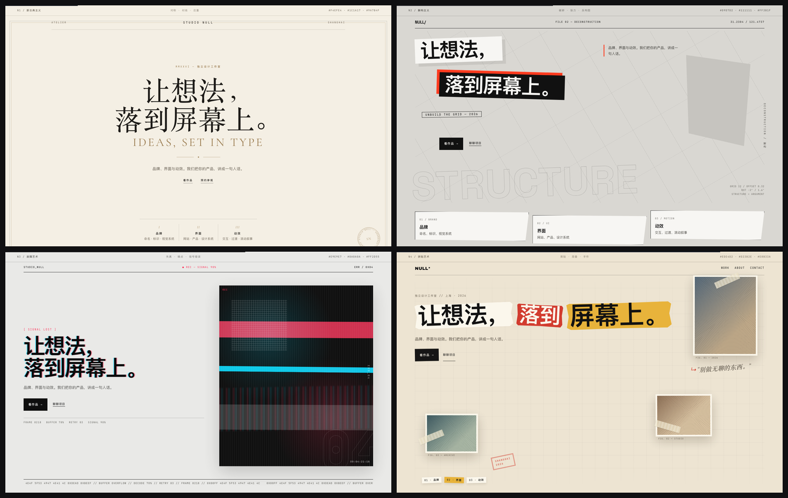

# AI Design Library

五种风格的前端设计规范，写给 AI 的“施工图”。

每份 `DESIGN.md` 不是灵感板，而是一份约束文件：**硬规则、色彩与字体 token、布局、组件、动效、文案、Tailwind v4 配置、可直接粘贴的 prompt、验收清单**。把它交给 Claude Code / Cursor / ChatGPT，让 AI 在写代码时不能自由发挥，你负责验收。



## 五种风格

| 风格 | 文档 | 一句话 | 视觉样本 |
|---|---|---|---|
| 极简瑞士 | [`design/swiss/DESIGN.md`](design/swiss/DESIGN.md) | 网格、留白、一个字重体系，只留一个暖红当事件 | [`style-probe.html#s1`](style-probe.html) |
| 新粗野主义 | [`design/brutalist/DESIGN.md`](design/brutalist/DESIGN.md) | 3px 黑边、硬阴影、大字、贴纸与跑马灯 | [`style-probe.html#s3`](style-probe.html) |
| 新古典主义 | [`design/neoclassic/DESIGN.md`](design/neoclassic/DESIGN.md) | 对称、双线框、Cormorant 高对比衬线、印章 | [`style-probe-2.html#n1`](style-probe-2.html) |
| 故障艺术 | [`design/glitch/DESIGN.md`](design/glitch/DESIGN.md) | RGB 分离、坏帧色带、时间码、ticker | [`style-probe-2.html#n3`](style-probe-2.html) |
| 拼贴艺术 | [`design/collage/DESIGN.md`](design/collage/DESIGN.md) | 碎纸标题、胶带、halftone 照片、印章 | [`style-probe-2.html#n4`](style-probe-2.html) |

## 30 秒开始

1. 选一份（按项目类型，别五份一起用）。
2. 复制到项目里：`design/DESIGN.md`。
3. 新开对话，第一句：

```
先读 design/DESIGN.md，把它当硬约束，不是参考。
先复述 §2 的 10 条规则，然后等我给任务。
```

之后按 [使用手册](design/HOW-TO-USE.md) 的 Step 1–5 分阶段推进：**token → 骨架 → 组件 → 动效 → 验收**。

## 使用手册

[`design/HOW-TO-USE.md`](design/HOW-TO-USE.md) 包含：

- 最短路径与工具接法（Claude Code / Cursor / 网页版 / v0）
- 五个阶段的可复制 prompt
- AI 跑偏时的纠正话术（按规则编号，不靠感觉）
- 验收步骤与常见错误

## 目录

```
.
├─ design/
│  ├─ README.md            索引：选型表、字体矩阵、混用规则
│  ├─ HOW-TO-USE.md        使用手册
│  ├─ swiss/DESIGN.md
│  ├─ brutalist/DESIGN.md
│  ├─ neoclassic/DESIGN.md
│  ├─ glitch/DESIGN.md
│  └─ collage/DESIGN.md
├─ style-probe.html        视觉样本 01：瑞士 / 粗野
├─ style-probe-2.html      视觉样本 02：新古典 / 故障 / 拼贴
├─ style-probe-2-preview.png
└─ assets/fonts/           本地 latin 子集 + fonts.css
```

## 本地预览

直接用浏览器打开 `style-probe.html` 或 `style-probe-2.html`。字体已本地化在 `assets/fonts/`，离线也能看；每个页面底部有 N1–N4 / S1–S4 导航，最后一屏是字体样本。

## 字体

六款 Google Fonts（SIL Open Font License），本地 latin 子集在 `assets/fonts/`：

- Inter — 正文底座
- Cormorant Garamond — 新古典标题
- Instrument Serif — 编辑感点缀 / 旁白
- Archivo Black — 粗野与拼贴标题
- Space Grotesk — 故障标题
- JetBrains Mono — 标签、数据、代码

中文不下载字体包，回退 `PingFang SC` / `Songti SC`。

## 许可

- 文档内容 © liusolo123。
- 字体为 SIL Open Font License，可自由使用与再分发。
