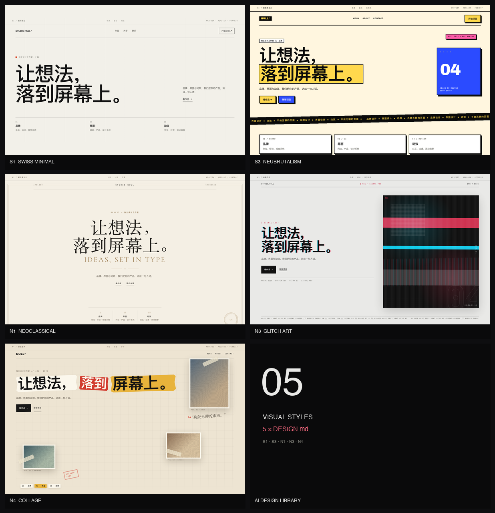

# AI Design Library

五种风格的前端设计规范，写给 AI 的“施工图”。

每份 `DESIGN.md` 不是灵感板，而是一份约束文件：**硬规则、色彩与字体 token、布局、组件、动效、文案、Tailwind v4 配置、可直接粘贴的 prompt、验收清单**。把它交给 Claude Code / Cursor / ChatGPT，让 AI 在写代码时不能自由发挥，你负责验收。



## 五种风格

| 风格 | 文档 | 一句话 | 预览 / 交互 |
|---|---|---|---|
| 极简瑞士 | [`design/swiss/DESIGN.md`](design/swiss/DESIGN.md) | 网格、留白、一个字重体系，只留一个暖红当事件 | [预览](previews/s1-swiss.png) · [交互](style-probe.html#s1) |
| 新粗野主义 | [`design/brutalist/DESIGN.md`](design/brutalist/DESIGN.md) | 3px 黑边、硬阴影、大字、贴纸与跑马灯 | [预览](previews/s3-brutalist.png) · [交互](style-probe.html#s3) |
| 新古典主义 | [`design/neoclassic/DESIGN.md`](design/neoclassic/DESIGN.md) | 对称、双线框、Cormorant 高对比衬线、印章 | [预览](previews/n1-neoclassic.png) · [交互](style-probe-2.html#n1) |
| 故障艺术 | [`design/glitch/DESIGN.md`](design/glitch/DESIGN.md) | RGB 分离、坏帧色带、时间码、ticker | [预览](previews/n3-glitch.png) · [交互](style-probe-2.html#n3) |
| 拼贴艺术 | [`design/collage/DESIGN.md`](design/collage/DESIGN.md) | 碎纸标题、胶带、halftone 照片、印章 | [预览](previews/n4-collage.png) · [交互](style-probe-2.html#n4) |

上面是五种风格的总览拼图（`previews/overview.png`），每张完整截图在 `previews/` 下。

两个 probe 里共有 8 个方向，其中 **S2 玻璃与极光、S4 赛博朋克、N2 解构主义**目前只有视觉样本，还没有写 DESIGN.md。

## 30 秒开始

1. 选一份（按项目类型，别五份一起用）。
2. 复制到项目里：`design/DESIGN.md`。
3. 新开对话，第一句：

```
先读 design/DESIGN.md，把它当硬约束，不是参考。
先复述 §2 的 10 条规则，然后等我给任务。
```

之后按 [使用手册](design/HOW-TO-USE.md) 的 Step 1–5 分阶段推进：**token → 骨架 → 组件 → 动效 → 验收**。

## 使用手册

[`design/HOW-TO-USE.md`](design/HOW-TO-USE.md) 包含：

- 最短路径与工具接法（Claude Code / Cursor / 网页版 / v0）
- 五个阶段的可复制 prompt
- AI 跑偏时的纠正话术（按规则编号，不靠感觉）
- 验收步骤与常见错误

## 目录

```
.
├─ design/
│  ├─ README.md            索引：选型表、字体矩阵、混用规则
│  ├─ HOW-TO-USE.md        使用手册
│  ├─ swiss/DESIGN.md
│  ├─ brutalist/DESIGN.md
│  ├─ neoclassic/DESIGN.md
│  ├─ glitch/DESIGN.md
│  └─ collage/DESIGN.md
├─ previews/               五张完整预览 + overview.png
├─ style-probe.html        视觉样本 01：瑞士 / 玻璃 / 粗野 / 赛博
├─ style-probe-2.html      视觉样本 02：新古典 / 解构 / 故障 / 拼贴
└─ assets/fonts/           本地 latin 子集 + fonts.css
```

## 本地预览

直接用浏览器打开 `style-probe.html` 或 `style-probe-2.html`。字体已本地化在 `assets/fonts/`，离线也能看；每个页面底部有 N1–N4 / S1–S4 导航，最后一屏是字体样本。

不想打开 HTML 也可以直接看 `previews/` 里的五张完整截图。

> 在 GitHub 上直接点开 HTML 只会看到源码；要看到渲染效果，请克隆到本地打开，或开启仓库的 GitHub Pages。

## 字体

六款 Google Fonts（SIL Open Font License），本地 latin 子集在 `assets/fonts/`：

- Inter — 正文底座
- Cormorant Garamond — 新古典标题
- Instrument Serif — 编辑感点缀 / 旁白
- Archivo Black — 粗野与拼贴标题
- Space Grotesk — 故障标题
- JetBrains Mono — 标签、数据、代码

中文不下载字体包，回退 `PingFang SC` / `Songti SC`。

## 许可

- 文档内容 © liusolo123。
- 六款拉丁字体均为 **SIL OFL 1.1**：可商用、可修改、可再分发；再分发字体文件时请保留 [`assets/fonts/LICENSES/`](assets/fonts/LICENSES/) 中的许可证与版权行。详见 [`assets/fonts/README.md`](assets/fonts/README.md)。
- 中文 `PingFang SC` / `Songti SC` 是系统字体，未随仓库分发，也不能自行打包再分发；需要跨平台一致时改用 Noto Sans SC / Noto Serif SC（OFL）。
